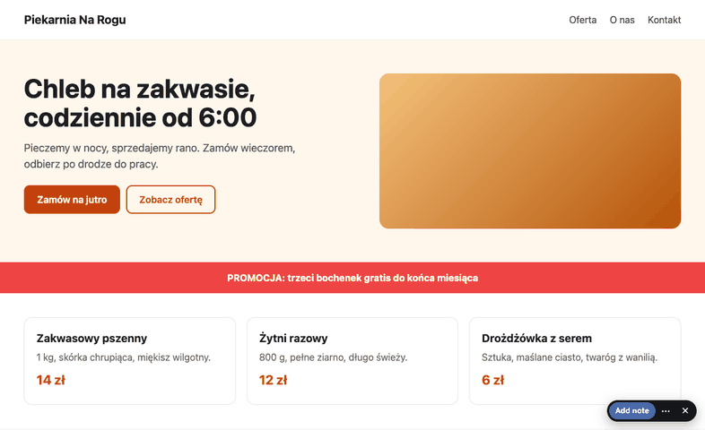
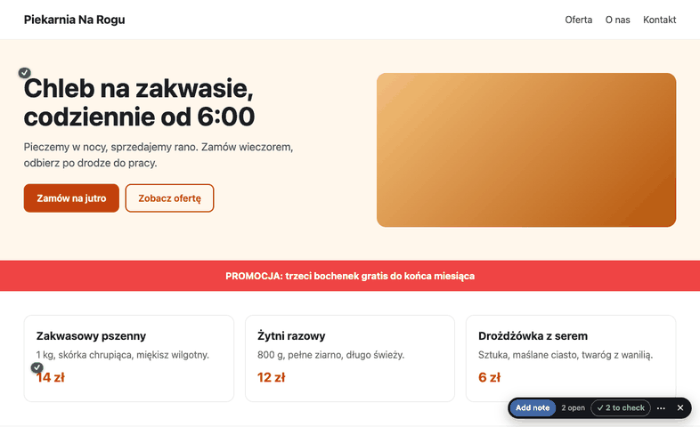

# Site Notes - notes on web page elements, for the AI agent that fixes them

**Live, with a test drive on the page itself: https://sitenotes.maciejjankowski.com/**

Mark everything on the live page, the agent fixes it in one pass, you keep or revert each change where it happened.





Krug pass of 2026-10-17 (18 friction points found and fixed): `docs/2026-10-17/roast.md`.

Click an element, say what should change (or press Remove element), and the agent gets every note of a site,
grouped by page, with the CSS selector, element HTML/text, the YAML source (`data-src`) and, from the extension, a screenshot.

One file, `extension/content.js`, runs two ways:

| | Who | Where | Notes go to |
|---|---|---|---|
| **Extension** (`extension/`) | MJ | any site | the site's own hub if it has one, else your local hub (URL set by `install.sh`) |
| **Script on the site** (`/notes/notes.js`) | anyone with the site's secret link (a client) | sites with `/notes/` | the site's own hub `https://SITE/notes/` |

Sites with their own hub are listed in `.secrets/sites/*.env` (git-ignored). The old `annotator.js` drop-in is retired: the file on those sites is
now a loader for `/notes/notes.js`; its notes were copied into the new hubs; the old folders are backed up on the server
next to each web root (`domains/SITE/annotations_backup_2026-10-07/`).

## Script on a site
- Secret link: `https://SITE/#notes=KEY` (or `#notes=KEY&who=Name`). Old `#annot=KEY` links keep working (same key).
  Key: `.secrets/sites/SITE.env`. Without the key in the browser nothing shows and nothing is loaded from the hub.
- Starts paused (links work); **Add note** on the pill turns note mode on (the button then says **Done**), and it stays on while moving between pages.
  ✕ hides the pill into a tab at the right edge; **Turn off** (in the ⋯ menu) hides it until the tab is closed. No screenshots (a page cannot capture itself); asks the name once if the link had no `&who=`.
- Add a site: `./install-site.sh DOMAIN WEBROOT` (MyDevil; SSH account in `.secrets/deploy.env`, `SN_SSH`): copies the hub + notes.js into `WEBROOT/notes/`, turns
  `assets/js/annotator.js` into the loader, writes the server key, uploads only `notes/` and the loader, copies old notes,
  writes `.secrets/sites/DOMAIN.env`. The site's deploy must exclude `notes/data/` and `notes/secret.php`, and a Jekyll
  `_config.yml` must list `notes/.htaccess` and `notes/data/.htaccess` under `include:` (done for the five sites above).
- After changing `extension/content.js` or `hub/`: `./update-sites.sh` pushes them to every site hub (and into each repo).
- New layout tag instead of the loader: `<script src="/notes/notes.js" data-site-notes defer></script>`.
- **Test drive on a page, nothing sent:** `<script src="notes.js" data-site-notes data-demo data-seed='[{"selector":".hero p","comment":"shorter","before":"...","fix":"what changed | for the agent"}]' defer>`:
  no hub, no key, notes live in that browser's localStorage, the seeds show up as changes to Keep or Revert. Used on the showcase (`docs/2026-10-17/showcase/`).

## Extension

### Setup (once)
1. `./install.sh` writes the key into `.secrets/hub.env`, `hub/secret.php` and `extension/defaults.js` (all git-ignored)
   and links `hub/` to your local web server (the hub URL you pass to `install.sh`; a local Apache/PHP works)
2. Chrome (or Brave, Opera, Edge): `chrome://extensions` > Developer mode > **Load unpacked** > `~/code/annotator/extension`.
   Chrome warns "read and change all your data on all websites": the extension needs that to keep note mode on
   while you move between pages and to take the screenshot. It does nothing until you click its icon.

Remote hub (e.g. a MyDevil subdomain) instead of the QA server: rsync `hub/` there (without `data/`),
run `./install.sh https://notes.example.org` with a NEW key (delete `.secrets/hub.env` first), reload the extension.

### Demo hosts: always on
Every page of the demo hosts (listed in `.secrets/deploy.env`, `SN_DEMO_HOSTS`) gets Site Notes appended server-side
(`the-template/scripts/pin-gate/host-root/`: `.htaccess` maps .html to PHP, `.user.ini` auto_append_file,
`_notes_append.php` emits the tag with hub + key from `_notes.config.php`, written by `demo_publish.sh`, 403 by URL).
Phone or desktop: open the demo, the pill is there, no secret link. Notes land in the parent site's hub under the demo host.
`site` for the agent: `annot export <demo host>`.

### Any other site: bookmarklet
The hub page (`/notes/` on a site, or the QA hub) prints a bookmarklet that injects notes.js with the hub and key into
the current page. Desktop: drag it to the bookmarks bar. Phone (Brave/Chrome): bookmark any page, edit the bookmark,
paste the code as its address, then on the target site type the bookmark's name in the address bar and pick it.
Sites with a strict Content-Security-Policy block it; nothing to do about that. Injection lasts until the page reloads.

### Phone taps, desktop types
Open the site on the phone with the secret link, ⋯ menu > **Point from this phone**: every tap now sends the tapped element
(CSS selector + text + viewport) to the hub and opens no card. On the desktop, same site, ⋯ > **Type for the phone**: the card
opens on that element (it says which viewport tapped it), you type, Enter, next tap. The desktop follows the phone to
other pages of the site. Elements are matched by selector, then by text; "not found on this layout" means a phone-only
element. Polling every 0.7 s; Both survive page loads in that tab. Test: `python3 test/remote.py` (12 checks).

### Use
- Toolbar icon or **Alt+Shift+N** = note mode on for this tab (badge ON). It stays on after every page load in the tab.
- Hover outlines an element (label = the site's own word for it: "price · 150 EUR", "link · Home"; the selector is in the tooltip), click picks it:
  the element gets a blue border, the rest of the page dims and blurs, and a small card opens:
  - type what should change, **Enter** (or Save) = **CHANGE**
  - path `page › cards › card` with **↑ bigger / ↓ smaller**: ↑ = parent, ↓ = back toward the element you clicked (undo).
    Click any crumb to jump there. Alt+↑ / Alt+↓ do the same from the keyboard.
  - **Selector** (folded): the CSS selector of the picked element; edit it to pick whatever it matches ("3 match" = not unique)
  - **Remove** = the element should go (text optional, as the reason)
  - Esc = cancel
- Then pick the next one. While note mode is on, clicks never reach the page (no links, no buttons).
- **ArrowUp / ArrowDown** while hovering = parent / back down before you click.
- **Esc** with no card = pause, so links work; "Paused" in the pill resumes.
- Numbered dots mark the open notes on the page (blue change, red remove); click one to edit, delete,
  or move it to another element (walk or edit the selector, then Save: new screenshot, history keeps the old selector).
  The pill's **n open** steps through them (a note on an element that is not visible on this layout says so).
- Pill: **Add note / Done**, **n open**, **✓ n to check**, **⋯** (List of all notes, Hide fixed, Point from this phone, Type for the phone,
  Export site for the agent, Turn off), **✕** = hide into a small tab at the right edge (note mode pauses, the page works; tap the tab to bring it back).
  Export site = every open note of the whole site (all pages), copied to the clipboard and saved as `Downloads/site-notes/<site>_<date>.md`.

Stored per note: site, page path and URL, page title, CSS selector, element HTML (trimmed) and text, position and viewport,
screenshot crop with the element outlined in red, comment, CHANGE/REMOVE, author, dates, status, and the
fix/reopen history (so a reopened note shows which fix did not work).

### Checking the agent's changes on the page
A fixed note does not disappear: it stays on the page as a **green ✓ marker**, also while paused (a hollow ✓ where the element was
removed or moved by the fix; no dashed box, the stored position is stale after a layout change). Click it: your note, the text from **before**, and **what changed** (the fix text). Then:
- **Keep**: the change stays, the marker goes away (status `accepted`).
- **Revert** (optional reason): the note goes back to the agent as **REVERT**: put the before state back, do not try
  another fix. The fix text names the patch to undo (see the P087 `fixes/fixlog.sh revert` convention).
- **✓ n to check** on the pill, or Alt+Shift+C: the page dims and only the changed elements stay lit; nothing opens until you click a ✓ or
  step with ‹ › (arrow keys); Esc leaves. Revert asks for a reason only after you press it; "Details for the agent" (the part of the fix text after ` | `) is folded. "n elsewhere" counts changes on other pages of the site.

### Other pages of the site
- **Link badges**: every visible link to another page of this site that has notes gets a small badge
  (blue `2` = open notes, green `✓3` = changes waiting for Keep/Revert). Shown while notes are on or paused.
- **List of all notes** in the ⋯ menu, or **Alt+Shift+L**: a sidebar with every page of the site that has open notes or changes,
  this page first. Click a page to go there; click a note to go there and open it (its card, or its change card).
  The list stays open while you move between pages (until the tab is closed).

### Agent side
```
bin/annot sites                            # every hub: sites with open / total notes
bin/annot export SITE [--all] [--json]     # all open notes of the site, grouped by page, Markdown by default
bin/annot -s SITE fix ID "what you changed"
bin/annot -s SITE reopen ID "why"
bin/annot -s SITE accept ID                # same as Keep on the green marker
bin/annot -s SITE revert ID "why"          # same as Revert; shows as REVERT in the export
bin/annot move SITE                        # local hub -> the site's own hub (screenshots included)
```
SITE is the host as in the address bar, with the port if any (`example.com`, `127.0.0.1:8080`).
`annot` picks the site's own hub when `.secrets/sites/SITE.env` exists, else the QA hub.
Screenshot paths in the export are local files (`hub/data/shots/ID.jpg`), readable directly.
Overview with screenshots and a **Not fixed** button for checking the agent's fixes: your local hub's `/` page
(first visit through the link on the extension's options page, it carries the key).

### Test
```
source ~/code/the-template/venv/bin/activate
python3 test/e2e.py    # extension, 50 checks
python3 test/page.py   # script on a site + hand-over to the extension, 22 checks
```
Both drive the installed Brave (`SN_BROWSER=...` for another Chromium browser; branded Chrome ignores `--load-extension`).
Never download a browser. Test notes (site `fixture.test`, paths `/sn-fixture/`) are deleted at the end (`--keep` leaves them).
